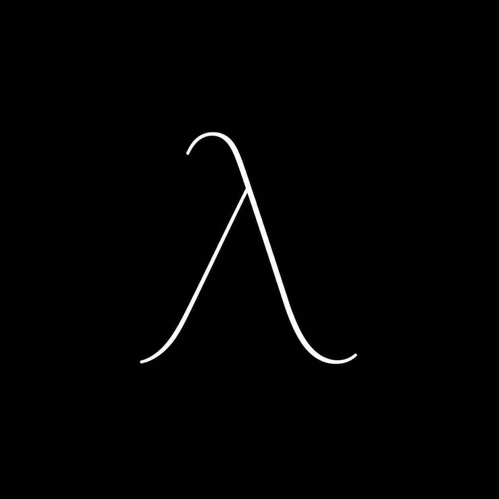

# Lenguajes de Programación

La teoría de lenguajes de programación es un área de las ciencias de la computación dedicada al estudio de los fundamentos matemáticos y computacionales que permiten definir, interpretar y razonar sobre los lenguajes de programación. A través de conceptos como la sintaxis, la semántica y los sistemas de tipos, estudia cómo se representa el significado de los programas, cómo se evalúan sus expresiones y qué propiedades pueden establecerse sobre su comportamiento. Estos fundamentos permiten comprender los principios que sustentan el diseño y la implementación de los lenguajes de programación.

Este curso ofrece una introducción a los fundamentos teóricos y prácticos de los lenguajes de programación, abordando conceptos como el cálculo lambda, los modelos de evaluación, los ambientes, la memoria, el estado y los sistemas de tipos. A lo largo del semestre, las personas estudiantes explorarán cómo se representa y ejecuta un programa mediante modelos formales y máquinas abstractas, complementando su estudio con implementaciones en Haskell. El enfoque busca fortalecer el razonamiento formal y la comprensión de los mecanismos que sustentan la ejecución de los programas, proporcionando herramientas conceptuales para el análisis y diseño de lenguajes de programación.

## Notas de clase

<ol>
	<li>
		<a href="https://drive.google.com/file/d/1HQ5sQ2yNUDY3F_6AeV0hKFxl0yWyNoUH/view?usp=drive_link" target="_blank">
			Historia de los lenguajes de programación
		</a>
	</li>
	<li>
		<a href="https://drive.google.com/file/d/1UDjAL0oT99abi1o0xzqpPKikooJ5hFFa/view?usp=drive_link" target="_blank">
			Componentes de los lenguajes de programación
		</a>
	</li>
	<li>
		<a href="https://drive.google.com/file/d/1hOR7MdCWJ2ahxAm5atQAEXTKh7_WV7ie/view?usp=drive_link" target="_blank">
			Clasificación de los lenguajes de programación
		</a>
	</li>
	<li>
		<a href="https://drive.google.com/file/d/1l8QUA4UA1kIvs4etxeWzb5RMbDgLU0rd/view?usp=drive_link" target="_blank">
			Sintaxis concreta
		</a>
	</li>
	<li>
		<a href="https://drive.google.com/file/d/1iikTy9Tzhuykk2yXToyhV-Wmj6p2UH4H/view?usp=drive_link" target="_blank">
			Sintaxis abstracta
		</a>
	</li>
	<li>
		<a href="https://drive.google.com/file/d/18yT-kvnuBP09qa5b4GGLlxn9W8oJ4My9/view?usp=drive_link" target="_blank">
			Semántica dinámica
		</a>
	</li>
	<li>
		<a href="https://drive.google.com/file/d/1-TwLdmH9U_nb546H3bPat5d9gMaWpt2e/view?usp=drive_link" target="_blank">
			Semántica estática
		</a>
	</li>
	<li>
		<a href="https://drive.google.com/file/d/1linm_G5LYTkW9cc9C_mRuhkDFb5Di_YL/view?usp=drive_link" target="_blank">
			Expresiones <code>let</code>
		</a>
	</li>
	<li>
		<a href="https://drive.google.com/file/d/1MFfzli-LHxe23KRysgKQAZyzTKMg1cln/view?usp=drive_link" target="_blank">
			El Cálculo λ como núcleo para funciones
		</a>
	</li>
	<li>
		<a href="https://drive.google.com/file/d/1Bqv_vnOLXUpBUUEaxyVJlGH-tx4wbpXq/view?usp=drive_link" target="_blank">
			Expresiones <code>lambda</code>
		</a>
	</li>
	<li>
		<a href="https://drive.google.com/file/d/1sLccW6UOw_Ja9L0rxlR-34nq1HCKyeSO/view?usp=drive_link" target="_blank">
			Ambientes de evaluación
		</a>
	</li>
	<li>
		<a href="https://drive.google.com/file/d/1yXdDgvsQEU8M5sjBDmde2a3VvQ9VhN53/view?usp=drive_link" target="_blank">
			Alcance estático y dinámico
		</a>
	</li>
	<li>
		<a href="https://drive.google.com/file/d/1CJ8wpP6Y6uY035y_F6kC9XUDtqRObRhn/view?usp=drive_link" target="_blank">
			Estrategias de evaluación
		</a>
	</li>
	<li>
		<a href="https://drive.google.com/file/d/1gf1ebPwXItNB6DpqZIS47amg42mNeVCN/view?usp=drive_link" target="_blank">
			Recursión
		</a>
	</li>
	<li>
		<a href="https://drive.google.com/file/d/1rOKq4-qHsYBnMT83GMHwNimbw8mwoW1B/view?usp=drive_link" target="_blank">
			Máquinas abstractas
		</a>
	</li>
	<li>
		<a href="https://drive.google.com/file/d/1OR0A7drg4YlqH7xCHRZCqVl4hpxMLKzT/view?usp=drive_link" target="_blank">
			Continuaciones
		</a>
	</li>
	<li>
		<a href="https://drive.google.com/file/d/1pfy_vSqQQiVB7a5xkZN2yqWW39cb_vJT/view?usp=drive_link" target="_blank">
			Programas secuenciales
		</a>
	</li>
	<li>
		<a href="https://drive.google.com/file/d/1jGPkk5b9lIbWy1B1VtrnC7iY2HkTvN_I/view?usp=drive_link" target="_blank">
			Estructuras de control
		</a>
	</li>
	<li>
		<a href="https://drive.google.com/file/d/1rXa3E5q3tNOe9pSIGl_Z1XB_pPIlsuXw/view?usp=drive_link" target="_blank">
			Variables vs. referencias
		</a>
	</li>
	<li>
		<a href="https://drive.google.com/file/d/1-jFin8JsNqMPPPToPhPvUAwHiJwFoHQ0/view?usp=drive_link" target="_blank">
			Técnicas de paso de parámetros
		</a>
	</li>
	<li>
		<a href="https://drive.google.com/file/d/1Gs8Q1H9ijtDoVpXNvX1EtmvbKJfhu2fG/view?usp=drive_link" target="_blank">
			Definición de sistema de tipos
		</a>
	</li>
	<li>
		<a href="https://drive.google.com/file/d/1tyN8yzEfNvF6t2huTzsJBg4zOKBaJMEq/view?usp=drive_link" target="_blank">
			Verificación de tipos
		</a>
	</li>
</ol>

## Intérpretes del curso

<ul>
	<li>
		<a href="https://github.com/lambdasspace/MINILISP" target="_blank">
			MiniLisp
		</a>
	</li>
	<li>
		<a href="https://github.com/manu-msr/tinyc" target="_blank">
			TinyC
		</a>
	</li>
</ul>

## Referencias de consulta

- S. Krishnamurthi, Programming Languages: Application and Interpretation, 2023.
- B. C. Pierce, Types and Programming Languages, MIT Press, 2002.
- M. Gabbrielli & S. Martini, Programming Languages: Principles and Paradigms, Springer, 2023.
- G. Winskel, The Formal Semantics of Programming Languages, MIT Press, 1993.
- H. R. Nielson & F. Nielson, Semantics with Applications: An Appetizer, Springer, 2007.
- K. D. Lee, Foundations of Programming Languages, Springer, 2017.
- A. Igarashi, B. C. Pierce & P. Wadler, “Featherweight Java: A minimal core calculus for Java and GJ,” ACM SIGPLAN Notices, vol. 34, no. 10, pp. 132–146, 1999.
